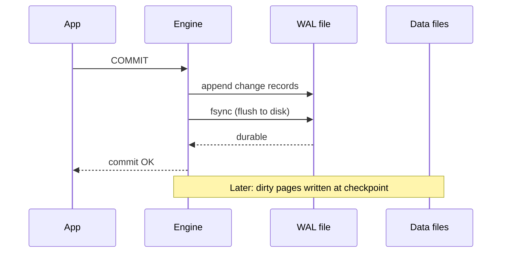

## 🎯 خلاصه

> **write-ahead log** (WAL) تضمین می‌کند که یک تغییر **قبل از** تأیید شدن، دائمی شده باشد: موتور تغییر را به یک log ترتیبی append می‌کند و آن را روی دیسک flush می‌کند. **MVCC** (multi-version concurrency control) اجازه می‌دهد خواننده‌ها و نویسنده‌ها هم‌زمان کار کنند، چون چند نسخه از هر ردیف را نگه می‌دارد و خواننده‌ها هرگز منتظر نویسنده‌ها نمی‌مانند.

- دوام از log می‌آید، نه از فایل‌های داده. بعد از crash، موتور log را دوباره اجرا می‌کند (replay).
- **checkpoint** ها مقدار log‌ای را که باید replay شود محدود می‌کنند، با flush کردن فایل‌های داده تا یک نقطه‌ی مشخص.
- MVCC به هر تراکنش یک **snapshot** می‌دهد. نسخه‌های قدیمی بعداً پاک می‌شوند (VACUUM در PostgreSQL، purge در InnoDB).
- همان log چیزی است که ابزارهای **CDC** می‌خوانند تا هر تغییر را از دیتابیس بیرون بکشند.

## 🌱 از ساده شروع کنیم (مبتدی)

> **💡 تشبیه:** یک صندوق‌دار بانک، پیش از اصلاح موجودی حساب مشتری، هر واریز را در **دفتر ثبت** می‌نویسد. اگر برق برود، دفتر می‌گوید چه اتفاقی افتاده و کار را دوباره می‌شود انجام داد. دفتر فقط به انتهایش اضافه می‌شود، پس نوشتنش سریع است.

ایده‌ی دوم: فرض کن یک گزارش موجودی‌ها را می‌خواند، در حالی که یک انتقال وسط کار است. یک **قفل** باعث می‌شود گزارش منتظر بماند. **MVCC** به‌جایش دو نسخه از موجودی نگه می‌دارد: نسخه‌ی قدیمی که گزارش می‌خواند و نسخه‌ی جدید که انتقال می‌نویسد. هر خواننده یک snapshot سازگار می‌بیند و هیچ‌کس منتظر نمی‌ماند.

دو سؤال را در ذهنت نگه دار:

- **چطور بعد از crash کار commit شده را از دست ندهیم؟** جواب: WAL.
- **چطور خواندن و نوشتن را هم‌زمان اجرا کنیم؟** جواب: MVCC.

## 🔧 واقعاً چطور کار می‌کند (متوسط)

### write-ahead log

قاعده ساده است: **رکورد log باید قبل از صفحه‌ی داده و قبل از تأیید commit به حافظه‌ی پایدار برسد.**



- append کردن به log یک **I/O ترتیبی** است که خیلی ارزان‌تر از نوشتن تصادفی صفحه است. به همین دلیل موتورها از طریق log commit می‌کنند و صفحه‌های داده را بعداً می‌نویسند.
- **fsync** از سیستم‌عامل می‌خواهد کش خودش را روی دستگاه flush کند. بدون آن، قطع برق می‌تواند داده‌ای را از بین ببرد که موتور فکر می‌کرد نوشته شده.
- موتورها commitها را دسته‌ای می‌کنند (**group commit**)، پس یک fsync می‌تواند چند تراکنش را دائمی کند.
- بازیابی، WAL را از آخرین checkpoint دوباره اجرا می‌کند. این replay قابل تکرار است: اعمال دوباره‌ی یک رکورد، همان صفحه را می‌دهد.

**checkpoint** ها صفحه‌های dirty را در فایل‌های داده می‌نویسند و یک نقطه (به نام «redo point») را ثبت می‌کنند که بازیابی باید از آن شروع شود. بین دو checkpoint، WAL رشد می‌کند. checkpointها با تایمر یا وقتی log به یک حد اندازه برسد اجرا می‌شوند، و باعث جهش I/O می‌شوند که باید پایش کنی.

در PostgreSQL، اولین تغییر یک صفحه بعد از checkpoint کل صفحه را داخل WAL می‌نویسد (`full_page_writes`). این از **torn page** جلوگیری می‌کند، یعنی حالتی که crash وسط نوشتن یک صفحه‌ی 8 KB رخ دهد و نیمی از آن نوشته شده باشد.

**تنظیمات دوام commit.** `synchronous_commit` در PostgreSQL را می‌شود برای تراکنش‌های خاص خاموش کرد. در این صورت، crash ممکن است آخرین commitها را از بین ببرد، اما دیتابیس سازگار می‌ماند، چون WAL همچنان به ترتیب نوشته می‌شود. این را فقط جایی استفاده کن که از دست رفتن چند ثانیه نوشتن قابل قبول باشد.

### MVCC: نسخه به جای قفل

در MVCC، یک `UPDATE` ردیف را بازنویسی نمی‌کند. یک **نسخه‌ی جدید** می‌سازد و نسخه‌ی قدیمی را «دیگر فعلی نیست» علامت می‌زند.

در PostgreSQL، هر نسخه‌ی ردیف تراکنشی را که آن را ساخته (`xmin`) و تراکنشی را که آن را حذف یا جایگزین کرده (`xmax`) ثبت می‌کند. تراکنش فقط وقتی یک نسخه را می‌بیند که آن نسخه پیش از گرفتن snapshot‌اش commit شده باشد.

```sql
-- Session A: long report
BEGIN ISOLATION LEVEL REPEATABLE READ;
SELECT balance FROM accounts WHERE id = 1;   -- sees 100

-- Session B: update, commits
BEGIN;
UPDATE accounts SET balance = 150 WHERE id = 1;
COMMIT;

-- Session A: same transaction, same snapshot
SELECT balance FROM accounts WHERE id = 1;   -- still sees 100
COMMIT;
```

Session A هیچ‌وقت Session B را بلاک نمی‌کند و برعکس. بهایش این است که نسخه‌های قدیمی تا وقتی هیچ‌کس به آن‌ها نیاز ندارد روی دیسک می‌مانند:

- **PostgreSQL** تاپل‌های قدیمی را در heap نگه می‌دارد تا **VACUUM** آن‌ها را پاک کند. اگر VACUUM عقب بماند، جدول و indexهایش با **bloat** بزرگ می‌شوند.
- **InnoDB** (MySQL) نسخه‌های قدیمی را در **undo log** نگه می‌دارد و وقتی هیچ read view‌ای به آن‌ها نیاز نداشته باشد پاک می‌کند. یک تراکنش طولانی، purge را عقب می‌اندازد.

**سطوح isolation.** MVCC مکانیزم است. سطح isolation تعریف می‌کند یک تراکنش چه چیزی را ببیند. پیش‌فرض PostgreSQL، READ COMMITTED است که در آن هر statement یک snapshot تازه می‌گیرد. REPEATABLE READ یک snapshot برای کل تراکنش می‌دهد (snapshot isolation). SERIALIZABLE بررسی‌هایی اضافه می‌کند که تراکنش‌هایی را رد می‌کند که معادل هیچ ترتیب سریالی نیستند. به [[isolation-level]] و [[sql-transactions]] نگاه کن.

### logical decoding و CDC

WAL تغییرات **فیزیکی** را ثبت می‌کند، مثلاً «این بایت‌ها را در صفحه‌ی 42 بنویس». برای CDC، دیتابیس می‌تواند WAL را به تغییرات **منطقی** decode کند، مثلاً «ردیف 7 در جدول `orders` از وضعیت `NEW` به `PAID` تغییر کرد».

- **PostgreSQL** این کار را با **logical decoding** انجام می‌دهد. یک output plugin (مثلاً `pgoutput` که logical replication از آن استفاده می‌کند، یا `wal2json`) رکوردهای WAL را به تغییرات ردیف تبدیل می‌کند. یک **replication slot** جلوی حذف WAL ای را می‌گیرد که مصرف‌کننده هنوز نخوانده است.
- **MySQL** یک **binary log** (binlog) می‌نویسد. با `binlog_format = ROW` که از MySQL 5.7.7 پیش‌فرض بوده، هر تغییر ردیف ثبت می‌شود. Debezium از binlog می‌خواند تا تغییرات را منتشر کند.

slot قدرتمند و خطرناک است. یک slot غیرفعال باعث می‌شود سرور همه‌ی WAL از موقعیت slot به بعد را نگه دارد و دیسک پر شود. lag مربوط به slot را پایش کن و slotهایی را که کسی نمی‌خواند حذف کن. به [[cdc]] و [[replication]] نگاه کن.

### checkpoint در Flink چیز دیگری است

کلمه‌ی «checkpoint» در stream processing معنای دیگری هم دارد. checkpoint در Flink یک snapshot سازگار از state اپراتورها روی taskهای موازی است که با barrier هایی که داخل جریان داده حرکت می‌کنند گرفته می‌شود. این همان checkpoint دیتابیس نیست. هر دو هدف مشترک محدود کردن کار بازیابی را دارند و هر دو به log یا source نیاز دارند تا از یک موقعیت معلوم دوباره بخوانند. به [[checkpoint]] و [[exactly-once]] نگاه کن.

## 🧠 عمق و trade-offها (سنیور)

- **fsync گلوگاه واقعی است.** تأخیر commit را سرعت flush کردن دستگاه تعیین می‌کند. group commit و کش‌های SSD با باتری یا سازمانی این عدد را خیلی تغییر می‌دهند. قبل از تغییر تنظیمات دوام، روی سخت‌افزار خودت بنچمارک بزن.
- **تنظیم checkpoint یک trade-off است.** checkpoint بار تکرار بیشتری بیاورد، زمان بازیابی بعد از crash کوتاه‌تر می‌شود ولی جهش‌های نوشتن و full-page writeهای بیشتری داری. checkpoint کم‌تکرار یعنی replay طولانی بعد از crash.
- **تراکنش‌های طولانی به MVCC ضربه می‌زنند.** یک کوئری طولانی یا تراکنش بیکار، یک snapshot قدیمی را نگه می‌دارد. VACUUM (PostgreSQL) یا purge (InnoDB) نسخه‌هایی را که شاید هنوز لازم باشند پاک نمی‌کند، پس bloat و رشد undo به دنبالش می‌آید. timeout برای تراکنش بیکار تنظیم کن و سن قدیمی‌ترین تراکنش را پایش کن.
- **wraparound شناسه‌ی تراکنش (PostgreSQL).** شناسه‌های تراکنش 32-bit هستند. ردیف‌های قدیمی باید قبل از برگشتن شمارنده **freeze** شوند. autovacuum این کار را می‌کند، و در خطر wraparound، سرور برای محافظت از داده نوشتن را قبول نمی‌کند. سن قدیمی‌ترین XID بدون freeze را پایش کن.
- **snapshot isolation معادل serializable نیست.** در REPEATABLE READ (snapshot isolation)، **write skew** ممکن است: دو تراکنش داده‌ی هم‌پوشان را می‌خوانند، ردیف‌های جدا می‌نویسند و هر دو commit می‌کنند، و یک invariant مثل «حداقل یک پزشک در حال کشیک باشد» شکسته می‌شود. برای این قواعد از SERIALIZABLE یا قفل صریح استفاده کن.
- **replication slot در محیط واقعی.** logical replication و CDC به slot نیاز دارند و هر slot WAL را نگه می‌دارد. یک sink کند، مثلاً یک connector کافکا که متوقف شده، در دیتابیس منبع به یک حادثه‌ی دیسک‌پر تبدیل می‌شود. برای حجم WAL نگه‌داشته‌شده در هر slot هشدار بگذار.
- **ترتیب CDC در جریان.** تغییرات WAL به ترتیب commit در هر تراکنش می‌رسند. ترتیب بین جدول‌ها و partitionها فقط به قدرتی است که pipeline تو حفظ کند. قبل از این‌که به ترتیب تکیه کنی، طراحی [[pattern-cdc-analytics]] را بررسی کن.
- **کی به آن تکیه نکنیم.** WAL یک فرمت داخلی موتور است و چیدمانش بین نسخه‌ها تغییر می‌کند. یکپارچه‌سازی‌ها را روی رابط‌های logical decoding یا binlog بساز، نه روی خواندن فایل‌های خام WAL.

## 🧪 امتحان کن

1. **دوام.** یک commit ، 200 بایت WAL می‌نویسد و دیسک برای هر fsync یک میلی‌ثانیه طول می‌کشد. بدون group commit، حداکثر چند commit در ثانیه روی یک اتصال ممکن است؟ اگر 50 تراکنش یک fsync را شریک باشند، با group commit چه تغییری می‌کند؟
2. **snapshot ها.** یک تراکنش REPEATABLE READ شروع می‌شود، بعد تراکنش دیگری یک ردیف را از 100 به 150 تغییر می‌دهد و commit می‌کند. تراکنش اول چه چیزی می‌خواند؟ در READ COMMITTED چه چیزی فرق می‌کند؟
3. **bloat.** یک جدول یک‌میلیون ردیف زنده دارد و هر روز همه‌ی ردیف‌ها را یک بار به‌روز می‌کند. بدون در نظر گرفتن index و چیدمان صفحه، تقریباً چند نسخه‌ی مرده‌ی ردیف درست قبل از اجرای VACUUM وجود دارد؟
4. **replication slot.** موقعیت تأییدشده‌ی یک slot 40 GB از موقعیت فعلی WAL عقب است. دو علت ممکن را نام ببر و اولین کوئری‌ای را که اجرا می‌کنی بنویس.

<details><summary>پاسخ‌ها را ببین</summary>

**1.** بدون group commit: 1 / 0.001 ثانیه = حداکثر 1,000 commit در ثانیه روی یک اتصال، چون هر commit منتظر یک fsync است. با group commit و 50 تراکنش که یک fsync را شریک‌اند، همان دستگاه می‌تواند حدود 50,000 تراکنش در ثانیه را دائمی کند، اگر پهنای باند log اجازه بدهد. بایت‌ها هنوز مهم‌اند: 50 × 200 بایت یعنی 10 KB در هر flush.

**2.** تراکنش اول همچنان 100 را می‌خواند، چون snapshot‌اش پیش از commit شدن به‌روزرسانی گرفته شده بود. در READ COMMITTED، هر statement یک snapshot تازه می‌گیرد، پس statement بعدی 150 را می‌خواند.

**3.** هر به‌روزرسانی روزانه یک نسخه‌ی جدید می‌سازد و نسخه‌ی قبلی را مرده می‌گذارد. بعد از یک روز، تقریباً یک‌میلیون نسخه‌ی مرده قبل از VACUUM وجود دارد، پس جدول حدود دو میلیون نسخه‌ی ردیف برای یک‌میلیون ردیف زنده دارد. عدد دقیق به زمان‌بندی و HOT updateها بستگی دارد.

**4.** علت‌های ممکن: مصرف‌کننده متوقف شده یا خطا می‌دهد، یا موقعیت‌ها را خیلی کم تأیید می‌کند. یک تراکنش طولانی روی منبع هم می‌تواند decoder را عقب نگه دارد. اولین بررسی وضعیت slot و lag آن است، مثلاً `SELECT slot_name, active, restart_lsn, confirmed_flush_lsn FROM pg_replication_slots;` به‌همراه موقعیت فعلی WAL. بعد لاگ‌ها و اتصال مصرف‌کننده را بررسی کن.

</details>

## 💬 گوشه‌ی مصاحبه

**سؤال: «دیتابیس دوام را چطور تضمین می‌کند؟»** جواب متوسط: «قبل از تأیید commit، یک رکورد را در WAL می‌نویسد و fsync می‌کند. صفحه‌های داده بعداً نوشته می‌شوند و بعد از crash، log را دوباره اجرا می‌کند.» جواب سنیور: «WAL باعث می‌شود تأخیر commit به fsync وابسته باشد، پس group commit و رفتار flush دستگاه را بررسی می‌کنم. checkpoint را طوری تنظیم می‌کنم که زمان بازیابی و جهش‌های نوشتن تعادل داشته باشند، و می‌گویم که `synchronous_commit` کمی از دوام را در برابر تأخیر کمتر معامله می‌کند.»

**سؤال: «MVCC چطور اجازه می‌دهد خواندن و نوشتن هم‌زمان اجرا شوند؟»** جواب متوسط: «به‌روزرسانی‌ها نسخه‌ی جدید ردیف می‌سازند و هر تراکنش نسخه‌ای را می‌خواند که پیش از snapshot‌اش commit شده، پس خواننده‌ها قفلی نمی‌گیرند که نویسنده‌ها به آن نیاز داشته باشند.» جواب سنیور: «هزینه، نسخه‌های قدیمی و پاک‌سازی آن‌ها است. یک تراکنش طولانی VACUUM را بلاک می‌کند و bloat رشد می‌کند. همچنین می‌گویم snapshot isolation اجازه‌ی write skew می‌دهد، پس invariantهای بین ردیف‌ها به serializable یا قفل صریح نیاز دارند.»

**سؤال: «چطور هر تغییر را از Postgres به یک warehouse استریم کنی؟»** جواب سنیور: «logical decoding از طریق یک replication slot، خوانده‌شده توسط Debezium یا یک مصرف‌کننده‌ی logical replication. lag مربوط به slot را پایش می‌کنم، چون یک slot غیرفعال WAL را نگه می‌دارد و می‌تواند دیسک را پر کند. برای snapshot اولیه و رویدادهای تغییر مرتب هم برنامه دارم.»

> **🎤 این را در مصاحبه بگو:** «WAL با نوشتن ترتیبی و fsync، commitها را دائمی می‌کند و بازیابی آن را از آخرین checkpoint replay می‌کند. MVCC نسخه‌های ردیف را نگه می‌دارد تا خواننده‌ها نویسنده‌ها را بلاک نکنند. همان log، CDC را هم تغذیه می‌کند، و هزینه‌ای که باید پایش کنی عقب‌افتادگی VACUUM یا purge و نگه‌داشت WAL توسط replication slot است.»

## ⚠️ اشتباهات رایج

> **⚠️ حواست باشد:** خاموش کردن `fsync` برای سرعت. این خطر خرابی بعد از crash را دارد، نه فقط از دست رفتن commitها. خاموش کردن `synchronous_commit` برای یک تراکنش فقط خطر از دست رفتن آخرین commitهای همان را دارد.

> **⚠️ حواست باشد:** تراکنش بازی که در یک اپلیکیشن باز مانده. snapshot را نگه می‌دارد، VACUUM را بلاک می‌کند و bloat را بالا می‌برد، حتی اگر هیچ کاری نکند.

- فرض این‌که checkpoint همان commit است. commit وقتی دائمی است که WAL flush شده باشد. checkpoint فقط کار بازیابی را محدود می‌کند.
- فکر کردن MVCC یعنی «اصلاً قفل نیست». نویسنده‌ها هنوز ردیف‌هایی را که به‌روز می‌کنند قفل می‌کنند و DDL قفل‌های قوی‌تری می‌گیرد.
- خواندن فایل‌های خام WAL در یک pipeline، به‌جای استفاده از logical decoding یا API مربوط به binlog.
- ساختن یک replication slot برای CDC و فراموش کردن آن. بعد از حذف pipeline هم WAL را نگه می‌دارد.
- فرض این‌که REPEATABLE READ همه‌ی anomalyها را جلو می‌گیرد. جلوی write skew را نمی‌گیرد.

## ✅ خودت را بسنج

1. چرا وقتی رکورد WAL ای flush شد، commit دائمی است، حتی قبل از این‌که صفحه‌ی داده نوشته شود؟
   - A) صفحه‌ی داده اول نوشته می‌شود و WAL فقط یک پشتیبان است
   - B) بعد از crash، بازیابی می‌تواند صفحه‌ی داده را از رکوردهای WAL بازسازی کند
   - C) سیستم‌عامل صفحه را خودکار می‌نویسد
   - D) دوام فقط به checkpoint وابسته است

<details><summary>جواب</summary>

**B** — رکورد WAL خود تغییر را دارد، پس replay کردنش از آخرین checkpoint صفحه را بازسازی می‌کند. خود صفحه‌ی داده می‌تواند بعداً، در زمان checkpoint یا flush، نوشته شود.

</details>

2. هدف اصلی checkpoint چیست؟
   - A) دائمی کردن تراکنش‌ها
   - B) حذف نسخه‌های قدیمی ردیف
   - C) ثبت یک نقطه که بازیابی از آن شروع شود، تا replay کوتاه‌تر شود
   - D) انتخاب سطح isolation

<details><summary>جواب</summary>

**C** — checkpoint صفحه‌های dirty را تا یک نقطه‌ی معلوم flush می‌کند. بازیابی از همان‌جا شروع می‌شود، نه از ابتدای log.

</details>

3. در MVCC، یک SELECT ساده در سطح READ COMMITTED PostgreSQL چه چیزی را می‌بیند؟
   - A) snapshot از ابتدای تراکنش
   - B) آخرین نسخه‌های commit شده وقتی statement شروع می‌شود
   - C) تغییرات commit نشده‌ی تراکنش‌های دیگر
   - D) فقط ردیف‌هایی که هرگز به‌روز نشده‌اند

<details><summary>جواب</summary>

**B** — در READ COMMITTED، هر statement یک snapshot تازه از داده‌ی commit شده می‌گیرد. تغییرات commit نشده هرگز دیده نمی‌شوند.

</details>

4. **(سنیور)** دو پزشک کشیک هر کدام تعداد پزشکان کشیک را زیر snapshot isolation می‌خوانند، عدد 2 می‌بینند و هر کدام خودش را حذف می‌کند. هر دو commit می‌کنند و دیگر کسی کشیک نیست. این چه anomaly ای است و چه چیزی آن را درست می‌کند؟
   - A) dirty read که با READ COMMITTED درست می‌شود
   - B) write skew که با SERIALIZABLE یا قفل صریح روی قاعده‌ی مشترک درست می‌شود
   - C) lost update که با WAL بزرگ‌تر درست می‌شود
   - D) phantom read که با VACUUM درست می‌شود

<details><summary>جواب</summary>

**B** — دو تراکنش داده‌ی هم‌پوشان را می‌خوانند و ردیف‌های متفاوت می‌نویسند، پس snapshot isolation هر دو commit را اجازه می‌دهد. SERIALIZABLE الگوی خطرناک را تشخیص می‌دهد، یا می‌شود ردیف‌ها یا یک شمارنده‌ی مشترک را که قاعده به آن وابسته است قفل کرد.

</details>

5. **(سنیور)** یک replication slot برای CDC روی دیتابیس تولید به صدها گیگابایت WAL نگه‌داشته‌شده رسیده، و مصرف‌کننده هفته‌ی پیش متوقف شده. اقدام فوری درست و راه‌حل پایدار چیست؟
   - A) فایل‌های WAL را از پوشه‌ی داده پاک کن
   - B) دیتابیس را ری‌استارت کن تا slot پاک شود
   - C) مصرف‌کننده را درست کن یا از رده خارج کن، و اگر کسی نباید آن را بخواند slot را حذف کن، و برای حجم WAL نگه‌داشته‌شده در هر slot هشدار بگذار
   - D) `max_wal_size` را بالا ببر تا WAL رشد نکند

<details><summary>جواب</summary>

**C** — slot سرور را مجبور می‌کند WAL را تا تأیید مصرف‌کننده نگه دارد. پاک کردن دستی فایل‌های WAL کلاستر را خراب می‌کند. بالا بردن `max_wal_size` WAL نگه‌داشته‌شده را آزاد نمی‌کند. راه‌حل پایدار عملیاتی است: روی lag مربوط به slot هشدار بگذار و slotهایی را که کسی استفاده نمی‌کند بازنشسته کن.

</details>

## 🗂️ فلش‌کارت

| جلو | پشت |
|---|---|
| قاعده‌ی write-ahead log | رکورد log قبل از تأیید commit به حافظه‌ی پایدار می‌رسد |
| چرا نوشتن WAL سریع است | append ترتیبی است و صفحه‌های داده را می‌شود بعداً نوشت |
| کار fsync | از سیستم‌عامل می‌خواهد کشش را روی دستگاه flush کند تا با قطع برق از بین نرود |
| هدف checkpoint | محدود کردن کار بازیابی با flush کردن صفحه‌های dirty تا یک نقطه‌ی معلوم |
| ایده‌ی اصلی MVCC | به‌روزرسانی نسخه‌ی جدید ردیف می‌سازد، پس خواننده snapshot می‌بیند بدون بلاک کردن |
| چه چیزی VACUUM یا purge را عقب می‌اندازد | تراکنش یا snapshot قدیمی که شاید هنوز به نسخه‌های قدیمی نیاز دارد |
| write skew | دو تراکنش داده‌ی هم‌پوشان می‌خوانند، ردیف‌های متفاوت می‌نویسند و یک قاعده را می‌شکنند |
| logical decoding | رکوردهای فیزیکی WAL را به تغییرات سطح ردیف برای CDC تبدیل می‌کند |

## 🔗 ادامه

- [[storage-engines]] توضیح می‌دهد چرا WAL هم برای موتورهای B-tree و هم LSM مهم است.
- [[sql-transactions]] ACID و سطوح isolation را پوشش می‌دهد که MVCC پیاده‌سازی‌شان می‌کند.
- [[postgresql]] VACUUM، bloat و logical replication را در عمل نشان می‌دهد.
- [[cdc]] و [[pattern-cdc-analytics]] ایده‌های logical decoding و binlog را در یک pipeline به کار می‌برند.
- [[replication]] نشان می‌دهد WAL و binlog چطور به replicaها فرستاده می‌شوند.
- برای نسخه‌ی major خودت، فصل‌های WAL، VACUUM و replication در مستندات PostgreSQL را بخوان، پیش از این‌که به تنظیم مشخصی تکیه کنی.
