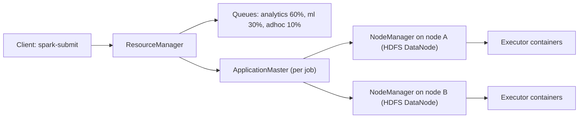
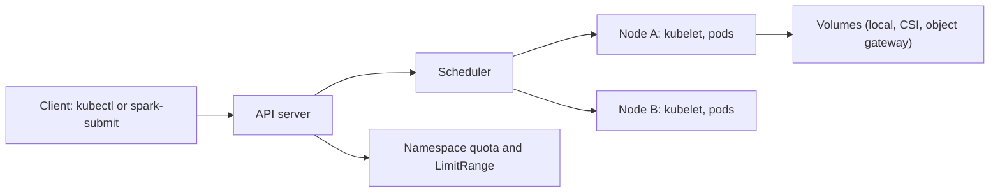

## 🎯 خلاصه

> **YARN** و **Kubernetes** به یک سؤال جواب می‌دهند: «این کار روی کدام ماشین، با چه مقدار CPU و حافظه اجرا شود، و چه کسی اجازه‌ی استفاده از آن را دارد؟» YARN برای Hadoop ساخته شد: از **data locality** (اجرای task همان‌جایی که بلاک‌های HDFS هستند) و **صف‌ها** با سهم ثابت برای هر تیم آگاه است. Kubernetes یک پلتفرم کانتینر عمومی است: هر چیزی را اجرا می‌کند، سرویس و job را یکجا نگه می‌دارد، ولی تا تو نگویی داده کجاست، آن را نمی‌داند.

- YARN: ResourceManager و NodeManagerها، **صف‌ها** (scheduler از نوع Capacity یا Fair)، زمان‌بندی آگاه از محل داده در HDFS.
- Kubernetes: API server، scheduler و kubeletها، **namespace**ها با ResourceQuota، podها روی هر node، و storage از طریق volume.
- هیچ‌کدام «بهتر» نیست. YARN با یک محیط Hadoop و HDFS موجود جور است. Kubernetes با پلتفرمی جور است که سرویس، streaming و batch را روی یک زیرساخت اجرا می‌کند و از object storage استفاده می‌کند.
- تفاوت‌های واقعی در **locality، چندمستأجری، تأخیر زمان‌بندی، عملیات و اکوسیستم** دیده می‌شوند.

## 🌱 از ساده شروع کنیم (مبتدی)

> **💡 تشبیه:** دو روش برای اداره‌ی یک دفتر مشترک. YARN مثل مدیر ساختمانی است که می‌داند هر کمد پرونده کجاست و به هر تیم یک طبقه می‌دهد تا افراد کنار پرونده‌هایشان کار کنند. Kubernetes مثل یک فضای کار اشتراکی انعطاف‌پذیر است: هر میز، هر تیم، قوانین یکسان برای همه، و پرونده‌ها در یک انباری مشترک نگه داشته می‌شوند که از طریق شبکه به آن می‌رسی.

هر دو سیستم کار پایه‌ی یکسانی انجام می‌دهند:

1. یک **job** منابع می‌خواهد: «به ۱۰ کانتینر با ۴ GB و ۲ CPU برای هر کدام نیاز دارم.»
2. **scheduler** nodeهایی با ظرفیت آزاد کافی پیدا می‌کند.
3. **عامل node** کانتینرها را اجرا و وضعیت را گزارش می‌دهد.
4. وقتی job تمام شد، منابع به استخر برمی‌گردند.

وقتی Spark را اجرا می‌کنی، می‌توانی انتخاب کنی executorهایش را کدام resource manager اجرا کند:

```bash
# روی YARN: executorها کانتینرهای YARN در یک صف مشخص هستند.
spark-submit --master yarn --queue analytics --num-executors 10 \
  --executor-memory 4g --executor-cores 2 job.py

# روی Kubernetes: executorها podهای یک namespace هستند.
spark-submit --master k8s://https://k8s-api.internal:6443 \
  --deploy-mode cluster \
  --conf spark.kubernetes.namespace=analytics \
  --conf spark.executor.instances=10 \
  --conf spark.executor.memory=4g \
  --conf spark.executor.cores=2 \
  --conf spark.kubernetes.container.image=registry.internal/spark:3.5.1 \
  local:///opt/app/job.py
```

کد Spark یکی است؛ resource manager یک انتخاب استقرار است. فلگ‌ها فرق دارند، و مفاهیم پشت آن‌ها هم.

## 🔧 واقعاً چطور کار می‌کند (متوسط)

### YARN در یک تصویر



- **ResourceManager** حسابداری منابع کلاستر و scheduler را در اختیار دارد.
- هر job یک **ApplicationMaster** دارد که برای آن کانتینر مذاکره می‌کند.
- **NodeManagerها** کانتینرها را روی هر node اجرا می‌کنند، معمولاً روی همان ماشین‌های DataNode در HDFS.
- **صف‌ها** ظرفیت را تقسیم می‌کنند. Capacity Scheduler به هر صف سهم تضمین‌شده می‌دهد و اجازه می‌دهد ظرفیت بی‌استفاده را قرض بگیرد؛ Fair Scheduler در طول زمان job های در حال اجرا را متعادل می‌کند. هر دو preemption دارند، با تنظیماتی که باید دقیق تنظیم شوند.

data locality ویژگی کلیدی است. وقتی یک task اسپارک بلاک HDFS را می‌خواند، YARN تلاش می‌کند آن را روی nodeای اجرا کند که یک replica از آن بلاک را دارد، تا بایت‌ها از شبکه رد نشوند. scheduler جای‌گذاری **node-local**، **rack-local** و **off-switch** را ردیابی می‌کند، و قبل از پذیرفتن یک جای‌گذاری دورتر، کمی برای یک slot محلی صبر می‌کند (delay scheduling).

### Kubernetes در یک تصویر



- **scheduler** هر pod را روی nodeای قرار می‌دهد که requestها، قوانین affinity و taintها را برآورده کند.
- **namespace**ها با **ResourceQuota** سقف مجموع درخواست‌های یک تیم را مشخص می‌کنند.
- **PriorityClass** مشخص می‌کند زیر فشار کدام podها اول بیرون رانده شوند.
- داده خودکار دنبال compute نمی‌رود. تو تعیین می‌کنی داده کجا باشد (object storage، دیتابیس، volume محلی)، و pod آن را از طریق شبکه می‌خواند.

### مقایسه‌ی کنار هم

| جنبه | YARN | Kubernetes |
|---|---|---|
| هدف اصلی | job های batch در Hadoop | ارکستریشن کانتینر عمومی |
| data locality | داخلی (جای‌گذاری بلاک HDFS) | داخلی نیست؛ با node affinity، volume محلی، یا خواندن از شبکه |
| چندمستأجری | صف‌ها با سهم تضمین‌شده | namespaceها با quota؛ سهم منصفانه نیاز به scheduler افزوده دارد |
| زمان‌بندی دسته‌ای | قوی: صف‌ها، رفتار gang-مانند برای Spark با تنظیمات | بهبود یافته با Volcano یا YuniKorn برای gang scheduling |
| سرویس‌های بلندمدت | ممکن، ولی تمرکز اصلی نیست | بومی (Deployment، StatefulSet، Service) |
| اکوسیستم | Hadoop، Hive، Spark و Flink روی YARN | operatorها برای Spark، Flink، Kafka، ClickHouse و بیشتر |
| عملیات | مهارت مدیریت Hadoop، ابزارهای Ambari یا Cloudera | مهارت Kubernetes، GitOps، Helm، گزینه‌های مدیریت‌شده در بعضی ابرها |
| مدل storage | HDFS، دیسک‌های هم‌مکان | object storage، volume از طریق CSI، دیتابیس؛ اغلب جدا از compute |

### trade-off در یک جمله

YARN **compute را به سمت داده** می‌برد. Kubernetes **داده را به سمت compute** می‌برد، از طریق شبکه، و به object storage سریع و caching متکی است تا این کار ارزان شود.

## 🧠 عمق و trade-offها (سنیور)

- **locality دیگر به اندازه‌ی گذشته مهم نیست.** وقتی storage یک object store جداشده (سازگار با S3) است، پهنای باند شبکه‌ی داخل data center آن‌قدر بالا است که بسیاری از jobهای سنگین در خواندن بدون locality خوب اجرا می‌شوند. اندازه بگیر: اگر job یک ترابایت بخواند و شبکه ۱۰ Gbit/s (حدود ۱٫۲۵ GB بر ثانیه) بدهد، خواندن در سرعت کامل حدود ۸۰۰ ثانیه زمان شبکه می‌گیرد، که ممکن است بر کل job غالب شود. قبل از نتیجه‌گیری که locality بی‌اهمیت است، این را با زمان compute job مقایسه کن.
- **تأخیر زمان‌بندی.** Kubernetes podها را یکی‌یکی با مجموعه‌ی وسیعی از قوانین زمان‌بندی می‌کند. برای یک job اسپارک با ۲٬۰۰۰ task کوتاه، هزینه‌ی start-up pod و pull کردن image می‌تواند غالب باشد. کانتینرهای YARN روی NodeManagerهای گرم برای انفجارهای کوتاه اغلب سریع‌تر شروع می‌شوند. این را با caching image، image های pre-pull شده و استفاده‌ی مجدد از executor حل کن، نه با فرض اینکه یکی همیشه سریع‌تر است.
- **gang scheduling.** بدون آن، دو job اسپارک ممکن است هر کدام نیمی از executorهایشان را بگیرند و برای همیشه منتظر بمانند. YARN با محدودیت صف و preemption ریسک را کم می‌کند؛ Kubernetes برای همان تضمین به Volcano یا YuniKorn نیاز دارد. قبل از پذیرفتن یک طراحی بپرس پلتفرم چطور از deadlock جلوگیری می‌کند.
- **جداسازی.** YARN با کانتینرها و cgroup و صف‌ها ایزوله می‌کند. Kubernetes با namespace و quota ایزوله می‌کند، ولی یک همسایه‌ی پرسروصدا روی همان node هنوز می‌تواند تأخیر را تحت تأثیر قرار دهد، مگر اینکه از node pool، requestهای برابر limit و priority class استفاده کنی.
- **مدل امنیتی.** Kerberos در Hadoop با Ranger یکپارچه است؛ Kubernetes از service account، RBAC، network policy و secret استفاده می‌کند. مهاجرت یعنی بازسازی مدل مجوزدهی، نه فقط scheduler. به [[data-security]] نگاه کن.
- **مسیر مهاجرت.** مسیر رایج این است که Spark روی Kubernetes کنار YARN اجرا شود، اول کارهای جدید منتقل شوند، و HDFS برای دیتاست‌های پایدار نگه داشته شود. قبل از انتقال compute، storage را با یک فرمت جدول باز مثل Iceberg به object storage ببر، وگرنه مزیت locality از بین می‌رود و فرض‌های قدیمی هنوز در کد باقی‌اند.
- **بلوغ عملیاتی.** YARN در محیط‌های Hadoop دهه‌ها دانش عملیاتی دارد. Kubernetes ابزار گسترده دارد ولی مهارت شبکه، storage و ارتقا می‌خواهد. بر اساس تیمی که داری انتخاب کن، نه بر اساس نموداری که دوست داری.
- **چه زمانی کدام.** YARN را برای یک پلتفرم Hadoop جاافتاده با HDFS، job های عمدتاً batch و مدیریت سخت‌گیرانه‌ی صف انتخاب کن. Kubernetes را برای پلتفرم جدید با بارهای کاری مختلط (streaming، سرویس، batch، ML) و ستون فقرات object storage انتخاب کن. فقط چون مد روز است Kubernetes را انتخاب نکن؛ تیمی که نتواند آن را اداره کند قطعی خواهد داشت.

> **⚠️ مراقب باش:** «Kubernetes جای YARN را می‌گیرد» فقط برای بارهای کاری‌ای درست است که منتقل می‌کنی. بسیاری از سازمان‌ها در یک انتقال طولانی هر دو را اجرا می‌کنند، و هزینه‌ی اجرای دو scheduler بخشی از تصمیم است.

## 🧪 امتحان کن

1. یک job اسپارک که می‌شناسی را انتخاب کن و دو دستور `spark-submit` بنویس، یکی برای YARN و یکی برای Kubernetes، با همان تعداد executor و حافظه. یک تفاوت در آنچه هر دستور از کلاستر می‌خواهد فهرست کن (صف، namespace، image، service account).
2. زمان شبکه برای خواندن ۲ TB از یک لینک مشترک ۱۰ Gbit/s را برای یک job، و برای ۲۰ job هم‌زمان حساب کن. توضیح بده چه زمانی locality آن زمان را ذخیره می‌کند و چه زمانی نه.
3. یک طرح صف کوتاه برای کلاستر YARN با سه تیم بنویس: `analytics` ۵۰٪، `ml` ۳۵٪، `adhoc` ۱۵٪. بگو وقتی `ml` بیکار است برای `adhoc` چه می‌شود، و اگر jobهای `analytics` زیاد منتظر بمانند چه چیزی را تنظیم می‌کنی.

<details><summary>جواب‌ها را نشان بده</summary>

**۱.** دستور YARN به نام صف و کلاستری نیاز دارد که NodeManagerها را اجرا می‌کند. دستور Kubernetes به آدرس API server، یک namespace، یک image کانتینر که Spark و job را دارد، و یک service account با مجوز ساختن pod نیاز دارد. کد Spark یکی است؛ الزامات پلتفرم فرق دارند.

**۲.** ۲ TB = ۲٬۰۰۰ GB؛ با ۱۰ Gbit/s = ۱٫۲۵ GB بر ثانیه، یک job اگر کل لینک را داشته باشد حدود ۱٬۶۰۰ ثانیه (حدود ۲۷ دقیقه) زمان شبکه نیاز دارد. بیست job که لینک را شریک‌اند هر کدام حدود یک بیستم پهنای باند را می‌گیرند، پس همان خواندن در مجموع حدود ۳۲٬۰۰۰ ثانیه زمان لینک می‌گیرد. locality با خواندن از دیسک‌های محلی این زمان شبکه را ذخیره می‌کند، که برای jobهای سنگین اسکن روی HDFS بیشترین فایده را دارد. وقتی داده از قبل روی object storage در شبکه‌ی دیگری است، یا job محدود به CPU است، کمکی نمی‌کند.

**۳.** وقتی `ml` بیکار است، Capacity Scheduler اجازه می‌دهد `analytics` و `adhoc` ظرفیت بی‌استفاده‌اش را (تا سقف‌های تنظیم‌شده) قرض بگیرند. اگر `analytics` خیلی منتظر بماند، سقف ظرفیت صف، محدودیت کاربر، تنظیمات preemption و اینکه `adhoc` منابع قرض‌گرفته را نگه داشته را بررسی کن. تنظیم preemption و حداقل‌های تضمین‌شده معمولاً بدون خرید سخت‌افزار مشکل را حل می‌کند.

</details>

## 💬 گوشه‌ی مصاحبه

**سؤال: «Spark را روی YARN اجرا می‌کنی یا روی Kubernetes؟»**

- **جواب متوسط:** «اگر Hadoop و HDFS داریم، روی YARN به خاطر صف‌ها و locality. اگر داریم یک پلتفرم جدید با object storage می‌سازیم، روی Kubernetes چون همه‌چیز را روی یک پلتفرم اجرا می‌کند.»
- **جواب سنیور:** «بستگی دارد به مدل storage و بارهای کاری. با HDFS و عمدتاً batch، locality و صف‌های YARN انتخاب قوی‌ای هستند و انتقال هزینه‌ی زیادی دارد. برای پلتفرم جدید با streaming، سرویس و ML، Kubernetes با object storage و یک فرمت جدول باز انعطاف بیشتری دارد. تأخیر زمان‌بندی و start-up image را برای taskهای کوتاه تست می‌کنم، و بررسی می‌کنم gang scheduling و quota چطور جلوی گرسنگی یک تیم به نفع تیم دیگر را می‌گیرند.»

> **🎤 این را در مصاحبه بگو:** «YARN locality و صف‌ها را اطراف HDFS به من می‌دهد. Kubernetes یک پلتفرم برای همه‌چیز با namespace و quota می‌دهد، ولی داده باید از طریق شبکه خوانده شود، پس لایه‌ی storage و caching را طوری طراحی می‌کنم که ارزان شود. سیستمی را انتخاب می‌کنم که با storage و تیم جور است، نه با بیشترین هیاهو.»

## ⚠️ اشتباهات رایج

> **⚠️ مراقب باش:** مقایسه‌ی این دو فقط بر اساس امکانات. تصمیم درباره‌ی این است که داده کجاست، چه کسی پلتفرم را اداره می‌کند، و تیم‌ها ظرفیت را چطور شریک می‌شوند.

- فرض اینکه Kubernetes خودکار data locality می‌دهد. این‌طور نیست.
- فراموش کردن اینکه یک job اسپارک روی Kubernetes به image ای نیاز دارد که نسخه‌های درست Spark، Java و Python را داشته باشد.
- تعیین ResourceQuota بدون در نظر گرفتن gang scheduling، طوری که jobها با نگه داشتن ظرفیت جزئی deadlock شوند.
- انتقال compute به Kubernetes در حالی که HDFS نگه داشته شده، و پرداخت هم برای خواندن شبکه و هم برای مدیریت کلاستر.
- نادیده گرفتن زمان start-up pod برای taskهای کوتاه Spark.
- استفاده از صف‌های YARN بدون تنظیم preemption، طوری که سهم‌های تضمین‌شده هرگز پس گرفته نشوند.

## ✅ خودت را بسنج

1. مزیت اصلی YARN برای یک پلتفرم batch مبتنی بر HDFS چیست؟
   - A) scheduler ندارد
   - B) data locality: taskها می‌توانند روی nodeهایی اجرا شوند که بلاک‌های داده را دارند
   - C) فقط job های streaming را اجرا می‌کند
   - D) نیاز به صف‌ها را حذف می‌کند

<details><summary>جواب</summary>

**B** — scheduler scheduler YARN YARN از جای بلاک‌های HDFS آگاه است و سعی می‌کند taskها را روی داده‌ی محلی اجرا کند. صف‌ها اشتراک منصفانه را مدیریت می‌کنند؛ locality جابه‌جایی داده را.

</details>

2. در Kubernetes چه چیزی به یک تیم سقف تضمین‌شده‌ی کل CPU و حافظه در کلاستر می‌دهد؟
   - A) یک Service
   - B) یک ResourceQuota در namespace تیم
   - C) یک ConfigMap
   - D) یک PersistentVolume

<details><summary>جواب</summary>

**B** — ResourceQuota سقف مجموع درخواست‌های یک namespace را تعیین می‌کند. Service ترافیک را هدایت می‌کند، ConfigMap تنظیمات را نگه می‌دارد، و PersistentVolume storage می‌دهد.

</details>

3. چرا gang scheduling برای Spark مهم است؟
   - A) Spark نیاز دارد همه‌ی executorها هم‌زمان شروع شوند، و تخصیص جزئی می‌تواند jobهایی را که هر کدام بخشی از ظرفیت را دارند deadlock کند
   - B) gang scheduling executorها را سریع‌تر می‌کند
   - C) تعداد shuffle partitionها را کم می‌کند
   - D) برای خواندن فایل‌های Parquet لازم است

<details><summary>جواب</summary>

**A** — jobی با ۵۰ executor که ۲۵ تا می‌گیرد نمی‌تواند پیش برود، و اگر دو چنین job هر کدام نیمی بگیرند، هیچ‌کدام تمام نمی‌شود. gang scheduling کل گروه را یکجا تخصیص می‌دهد یا هیچ‌کدام را.

</details>

4. **(سنیور)** تیمی پیشنهاد می‌دهد یک warehouse ۵۰۰ TB روی HDFS را بدون جابه‌جایی داده، compute را به Kubernetes منتقل کند. ریسک اصلی چیست؟
   - A) Kubernetes نمی‌تواند Spark را اجرا کند
   - B) حالا هر اسکن از شبکه رد می‌شود، چون مزیت locality از بین رفته و شبکه ممکن است گلوگاه شود؛ storage باید اول جابه‌جا یا cache شود
   - C) کانتینرها نمی‌توانند فایل‌های HDFS را بخوانند
   - D) Kubernetes نیاز دارد داده در یک فایل واحد باشد

<details><summary>جواب</summary>

**B** — compute روی Kubernetes داده‌ی HDFS را از طریق شبکه می‌خواند، پس job مزیت locality را از دست می‌دهد و ممکن است شبکه را اشباع کند. انتقال storage (یا یک لایه‌ی cache) را همراه انتقال compute برنامه‌ریزی کن.

</details>

5. **(سنیور)** چطور بین YARN و Kubernetes برای شرکتی با یک کلاستر Hadoop موجود و یک پلتفرم جدید streaming و ML تصمیم می‌گیری؟
   - A) همیشه Kubernetes، چون جدیدتر است
   - B) YARN را برای ناوگان batch پایدار HDFS نگه دار، و streaming و ML جدید را روی Kubernetes با object storage اجرا کن؛ تأخیر زمان‌بندی، ظرفیت عملیاتی و هزینه‌ی اجرای دو scheduler در دوره‌ی انتقال را بسنج
   - C) همیشه YARN، چون Hadoop متن‌باز است
   - D) هر کدام لایسنس ارزان‌تری داشت

<details><summary>جواب</summary>

**B** — تصمیم از بارهای کاری، storage و مهارت تیم پیروی می‌کند. رویکرد تقسیم‌شده در دوره‌ی انتقال رایج است و هزینه‌اش (دو scheduler، دو پشته‌ی عملیاتی) باید حساب شود.

</details>

## 🗂️ فلش‌کارت

| Front | Back |
|---|---|
| نقطه‌ی قوت اصلی YARN | data locality با HDFS و اشتراک مبتنی بر صف بین تیم‌ها |
| نقطه‌ی قوت اصلی Kubernetes | یک پلتفرم برای سرویس، streaming و batch، با namespace و API مشترک |
| کار یک صف YARN | به یک تیم سهم تضمین‌شده‌ی ظرفیت می‌دهد و اجازه می‌دهد ظرفیت بی‌استفاده را قرض بگیرد |
| کار یک namespace در Kubernetes | منابع و سیاست‌ها را محدود می‌کند؛ ResourceQuota سقف مجموع درخواست‌های تیم است |
| delay scheduling | YARN قبل از پذیرفتن یک node دورتر، برای یک slot محلی کمی صبر می‌کند |
| gang scheduling | همه‌ی podها یا کانتینرهای یک job را با هم تخصیص می‌دهد یا هیچ‌کدام را، تا deadlock تخصیص جزئی رخ ندهد |
| locality در Kubernetes | خودکار نیست؛ با node affinity، volume محلی یا caching به دست می‌آید |
| trade-off کلیدی | YARN compute را به داده می‌برد؛ Kubernetes داده را از طریق شبکه به compute می‌برد |

## 🔗 ادامه

- **[[spark-on-kubernetes]]** نشان می‌دهد driver و executorهای Spark چطور به صورت pod اجرا می‌شوند، با image، service account و dynamic allocation.
- **[[kubernetes-for-data]]** StatefulSet، storage و زمان‌بندی برای سیستم‌های داده روی Kubernetes را پوشش می‌دهد، از جمله schedulerهای batch مثل Volcano و YuniKorn.
- **[[hadoop-ecosystem]]** HDFS، YARN و بقیه‌ی پشته‌ی Hadoop را توضیح می‌دهد که YARN به آن خدمت می‌کند.
- **[[spark-architecture]]** و **[[spark-shuffle]]** مدل executor را توضیح می‌دهند و نشان می‌دهند چرا جابه‌جایی شبکه در shuffleها مهم است.
- **[[docker]]** image های کانتینری را پوشش می‌دهد که Kubernetes اجرا می‌کند.
- مستندات Apache Hadoop YARN را برای تنظیمات دقیق scheduler نسخه‌ات بخوان، و مستندات Kubernetes و Spark را برای تنظیمات منابع؛ پیش‌فرض‌ها بین نسخه‌ها فرق دارند.

